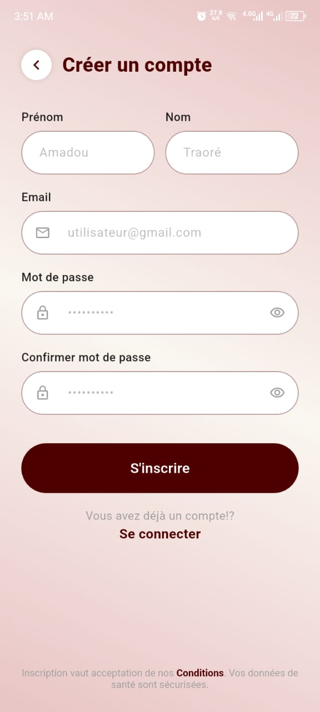
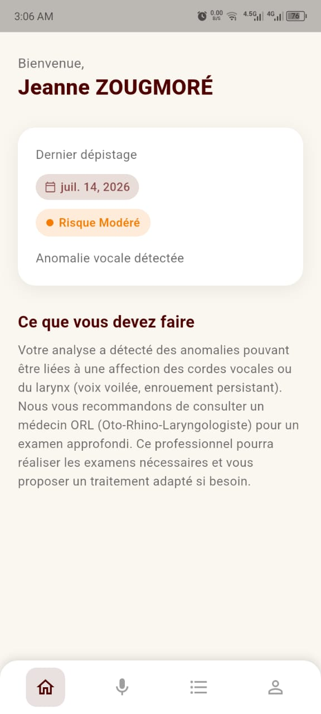
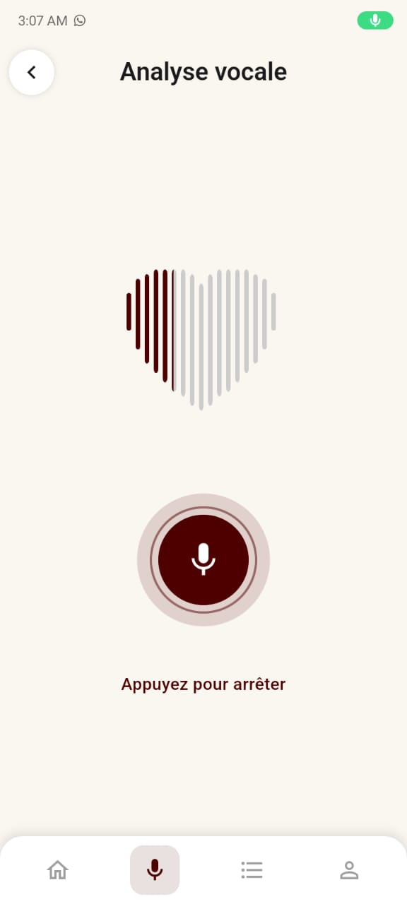
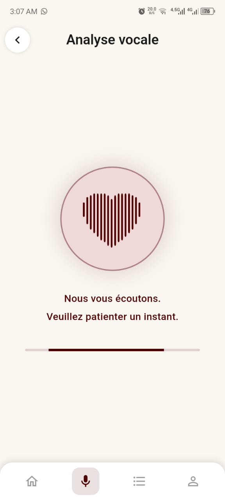
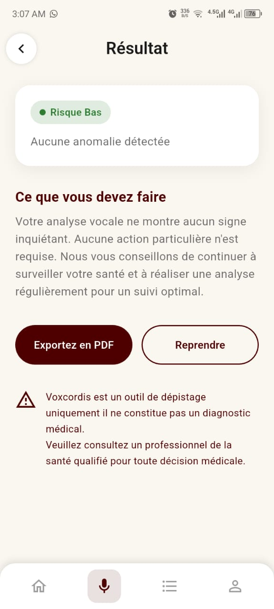
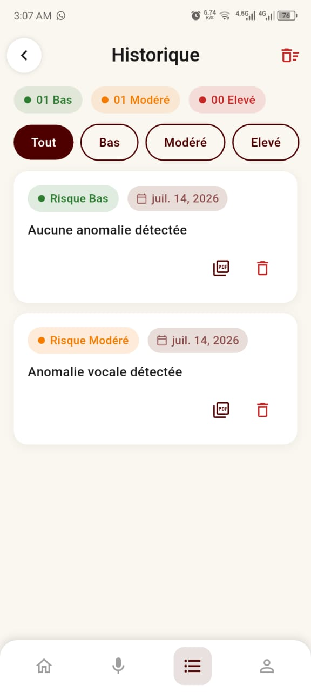
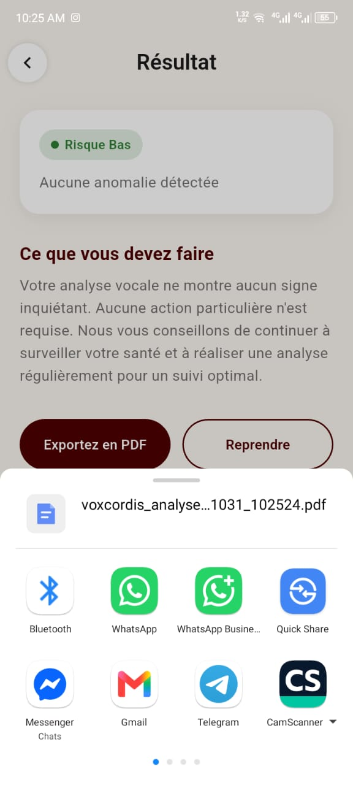

# Voxcordis

Dépistage précoce du risque cardiovasculaire par analyse vocale : l'utilisateur enregistre sa voix depuis son téléphone, un modèle IA (YAMNet + classifieur) estime son niveau de risque. **L'inférence s'exécute toujours sur le téléphone** (TFLite), le backend servant à l'authentification et à la synchronisation.

| Composant | Techno | Dossier |
|---|---|---|
| API REST | Python · FastAPI · TensorFlow · SQLAlchemy · PostgreSQL/SQLite | `voxcordis-api/` |
| Application mobile | Flutter (Android) · TensorFlow Lite · SQLite | `voxcordis_app/` |
| Scripts | Export YAMNet TF Hub → TFLite | `scripts/` |

> ⚠️ **Avertissement** : Voxcordis est un outil de dépistage uniquement. Il ne constitue pas un diagnostic médical. Les résultats doivent être interprétés par un professionnel de santé qualifié.

## Fonctionnalités

- **Compte** : inscription / connexion avec ou sans Internet (SQLite local en fallback), authentification JWT.
- **Guide vocal** : 3 étapes illustrées pour bien enregistrer.
- **Enregistrement** : 3 secondes, WAV 16 kHz mono.
- **Analyse** : inférence IA locale (TFLite) en temps réel, écran de chargement animé.
- **Résultat** : badge de risque (Faible / Modéré / Élevé), message personnalisé, recommandation, export PDF.
- **Historique** : filtres par niveau de risque, suppression, export PDF.
- **Synchronisation en ligne** : les analyses locales sont envoyées au backend en arrière-plan quand l'utilisateur est connecté (voir ci-dessous).

## Aperçu

> Déposez vos captures dans `docs/screenshots/` en respectant les noms de fichiers ci-dessous.

### Mobile — application Voxcordis

| Splash | Connexion | Inscription | Accueil | Guide |
|---|---|---|---|---|
|  |  |  |  |  |

| Enregistrement | Analyse | Résultat | Historique | Profil |
|---|---|---|---|---|
|  |  |  |  |  |

### Rapport PDF

| Export PDF |
|---|
|  |

## Architecture

```
voxcordis/
├── voxcordis_app/        # Application mobile Flutter (Android)
│   ├── lib/
│   │   ├── main.dart                   # Point d'entrée
│   │   ├── models/                     # Modèles de données
│   │   ├── providers/                  # State management (Provider)
│   │   ├── services/                   # Services (audio, TFLite, API, PDF)
│   │   ├── screens/                    # Écrans
│   │   ├── widgets/                    # Widgets réutilisables
│   │   └── database/                   # SQLite local
│   ├── android/app/src/main/kotlin/    # Plugin TFLite natif (Kotlin)
│   └── assets/models/                  # Modèles TFLite + scaler
│
├── voxcordis-api/        # Backend FastAPI (Python)
│   ├── main.py                         # FastAPI app
│   ├── core/
│   │   ├── model.py                    # Chargement & inférence Keras
│   │   ├── preprocessing.py            # YAMNet + extraction embedding
│   │   ├── risk.py                     # Logique de risque
│   │   └── auth.py                     # JWT auth
│   ├── routers/                        # Endpoints (/auth, /analysis/predict, /analysis/sync, /analysis/history)
│   └── models/                         # Modèles Keras entraînés
│
├── docs/screenshots/     # Captures d'écran du README
│
└── scripts/
    └── export_yamnet_tflite.py         # Export YAMNet hub → TFLite
```

### Pipeline d'inférence (locale, sur le téléphone)

```
Microphone (16 kHz)
    ↓ Enregistrement 3 s WAV
RMS Normalization
    ↓
YAMNet (TFLite) → Embedding [6, 1024]
    ↓ Moyenne temporelle
Embedding [1, 1024]
    ↓ StandardScaler (mean/std)
Scaled Embedding
    ↓
Classifier (TFLite) → Probabilités [Healthy, Laryngeal, Cardiac]
    ↓
Résultat + Risque + Recommandation
```

### Modes de fonctionnement

| Mode | Condition | Rôle |
|---|---|---|
| **Local** (toujours) | Aucune connexion requise | WAV → TFLite natif (YAMNet + Classifier) → SQLite local |
| **En ligne** | Internet + token JWT | Authentification backend + synchronisation des résultats (`/analysis/sync`) + historique distant (`/analysis/history`) |

L'analyse est **toujours effectuée localement** : le mode en ligne ne remplace pas l'inférence, il ajoute la synchronisation. Si le backend est injoignable ou l'utilisateur non authentifié, l'application reste pleinement fonctionnelle en local. Le endpoint serveur `/analysis/predict` existe toujours, mais l'application mobile ne l'utilise pas.

## Modèle

- **YAMNet** : modèle Google pré-entraîné sur AudioSet, utilisé comme extracteur d'embeddings (1024 dimensions).
- **Classifieur** : réseau de neurones entraîné par transfer learning sur des bases de données médicales vocales (SVD, PhysioNet).
- **TFLite** : modèles quantifiés (float16) pour l'inférence mobile.
- **3 classes** : Healthy (risque faible), Laryngeal (risque modéré), Cardiac (risque élevé).
- **Performances** : test accuracy **76,39 %** (train 84 %, validation 76 %).

## Stack technique

### Mobile (Flutter — Dart)

| Technologie | Rôle |
|---|---|
| `provider` | State management |
| `record` | Enregistrement audio WAV |
| `sqflite` | Base SQLite locale |
| `permission_handler` | Permission microphone |
| `http` | Communication avec l'API |
| `pdf` / `printing` | Génération et partage PDF |
| `intl` | Dates en français |
| `tensorflow-lite:2.17.0` | Inférence TFLite native Android |
| `tflite_native_service` | Pont Dart ↔ Kotlin |

### Backend (Python — FastAPI)

| Technologie | Rôle |
|---|---|
| FastAPI | Framework REST |
| TensorFlow 2.20.0 | YAMNet + classifieur Keras |
| TensorFlow Hub | YAMNet pré-entraîné |
| librosa | Chargement audio |
| joblib | Scaler de standardisation |
| SQLAlchemy | ORM |
| python-jose | Authentification JWT |
| bcrypt | Hash des mots de passe |

## Démarrage rapide

**Prérequis** : Flutter SDK ≥ 3.9 · Android SDK (API 34+) · JDK 11+ · Python ≥ 3.10 · appareil Android physique.

```bash
# Backend
cd voxcordis-api
python -m venv venv && source venv/bin/activate
pip install -r requirements.txt
uvicorn main:app --host 0.0.0.0 --port 7860 --reload

# Application mobile
cd voxcordis_app
flutter pub get
flutter run                      # debug → backend local
flutter build apk --release      # release → backend distant
```

- API : http://localhost:7860 · Swagger : http://localhost:7860/docs
- Connecter le téléphone au backend local : `adb reverse tcp:7860 tcp:7860`
- Le mode de build choisit automatiquement le backend : `flutter run` → backend local, `flutter build apk --release` → `https://voxcordis-api.onrender.com`.

Variables d'environnement du backend :

| Variable | Description |
|---|---|
| `SECRET_KEY` | Clé secrète JWT (obligatoire en prod) |
| `DATABASE_URL` | URL PostgreSQL ou SQLite |
| `ALLOWED_ORIGINS` | Origines CORS autorisées |
| `MODEL_PATH` | Chemin du modèle Keras |
| `SCALER_PATH` | Chemin du scaler joblib |

## Déploiement

**Backend (Render)** — la branche `backend` est celle déployée :

```bash
git checkout backend
git merge develop
git push origin backend
```

**Application mobile (Play Store)** :

1. Générer une keystore : `keytool -genkey -v -keystore upload-keystore.jks -alias upload -keyalg RSA -keysize 2048 -validity 10000`
2. Configurer les clés dans `android/key.properties`
3. Builder : `flutter build appbundle --release`
4. Le fichier `app-release.aab` est dans `build/app/outputs/bundle/release/`

## Scripts utiles

```bash
python scripts/export_yamnet_tflite.py   # Export YAMNet TF Hub → TFLite
./start_backend.sh                       # Lancer le backend
```

## Contexte académique

Projet de thèse de licence — Burkina Institute of Technology (BIT), année académique 2025-2026.
Supervision : Dr. Delwendé Lebian Serge Wilfried NIKIEMA.

## Auteur

VEBAMBA A. Carine — carinecontact.dev@gmail.com

## Licence

MIT
